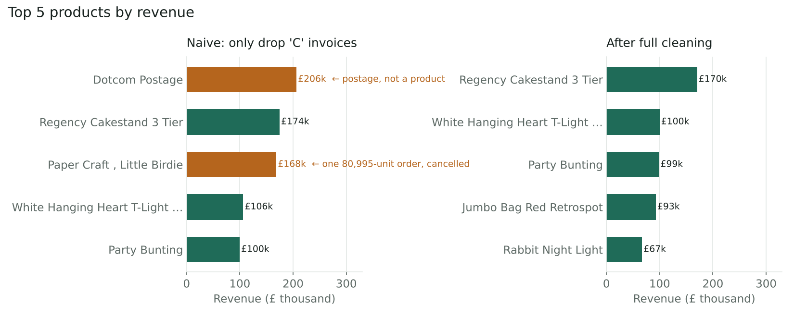
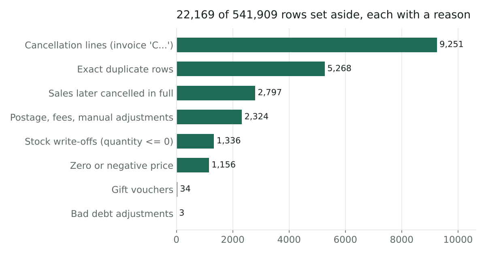

# Online Retail: Data Cleaning

Cleaning one year of real transaction data from a UK online gift shop so it can be trusted for analysis.

**Result:** 541,909 messy rows turned into 519,740 clean product sales. Every one of the 22,169 rows that was set aside is saved with the reason it was removed, so nothing disappears silently.



## Why cleaning matters here

A common shortcut is to drop only the cancelled invoices (those starting with `C`). On this dataset that shortcut gives wrong answers:

- The #1 "product" by revenue becomes **Dotcom Postage**, which is a shipping fee.
- **Paper Craft, Little Birdie** appears as the #3 product. All of its £168k comes from one order of 80,995 units that was cancelled minutes later.
- Total revenue is overstated by **£784,924 (8.0%)**: £10.64M instead of £9.86M.

## The data

| | |
|---|---|
| Source | [UCI Machine Learning Repository: Online Retail](https://archive.ics.uci.edu/dataset/352/online+retail) (Chen, 2015), licensed CC BY 4.0 |
| Period | 1 Dec 2010 – 9 Dec 2011 |
| Raw size | 541,909 rows × 8 columns |
| Columns | InvoiceNo, StockCode, Description, Quantity, InvoiceDate, UnitPrice, CustomerID, Country |

## Problems found

| Issue | Rows |
|---|---:|
| Missing CustomerID | 135,080 |
| Spaces before/after the description | 113,452 |
| Cancellation lines (invoice starts with `C`) | 9,288 |
| Exact duplicate rows | 5,268 |
| Non-product lines: postage, bank charges, Amazon fees, manual adjustments | 2,324* |
| Quantity ≤ 0 on a normal invoice (stock write-offs like "damaged") | 1,336* |
| Zero or negative unit price | 2,517 |
| Missing description | 1,454 |
| Dates stored as text in `M/D/YYYY H:MM` format | all |

\* counted after duplicates were removed.

## What the cleaning does

1. **Standardise text and types.** Trim and collapse whitespace in descriptions, upper-case stock codes, parse dates, keep IDs as text so codes like `85123A` survive.
2. **Standardise country names.** `EIRE` → Ireland, `RSA` → South Africa, `USA` → United States, `Unspecified` → Unknown.
3. **Remove exact duplicates.** First copy kept.
4. **Separate cancellations** into their own file instead of deleting them.
5. **Net out fully cancelled sales.** A sale is removed when a later cancellation has the same customer, stock code and quantity. Matching is one-to-one, so one cancellation never removes two sales. This step catches the 80,995-unit order.
6. **Set aside non-sales.** Postage, fees, gift vouchers, bad-debt adjustments, stock write-offs and zero-price lines.
7. **Add useful columns.** `Revenue = Quantity × UnitPrice` and `HasCustomerID`.

**Missing CustomerID is flagged, not filled in.** These are real sales from guest checkouts (131,387 clean rows). Guessing an ID would invent customers. Customer-level analysis should filter on `HasCustomerID`; revenue analysis can keep them.



## Output

| File | Contents |
|---|---|
| `data/clean/sales_clean.csv` | 519,740 product sales ready for analysis |
| `data/clean/cancellations.csv` | 9,251 cancelled order lines |
| `data/clean/removed_rows.csv` | 12,918 other set-aside rows, each with a `Reason` |
| `reports/cleaning_summary.json` | Row counts for every step |
| `data/sample/sales_clean_first_1000.csv` | Small preview of the clean file |

The three data files add back up to exactly 541,909 rows; the script checks this with an `assert`.

**Clean dataset at a glance:** 19,696 invoices · 3,794 products · 38 countries · £9.86M revenue.

## How to run

```bash
pip install -r requirements.txt
# put the raw file at data/raw/online_retail_raw.csv
python clean.py     # about 10 seconds
python charts.py    # rebuilds the two charts
```

The full raw and clean files are not stored in this repository because of their size (about 45 MB each). The sample file shows the clean format.

## Tools

Python · pandas · Matplotlib

---

Made by Aldo Fransisco · aldofransisco2008@gmail.com
